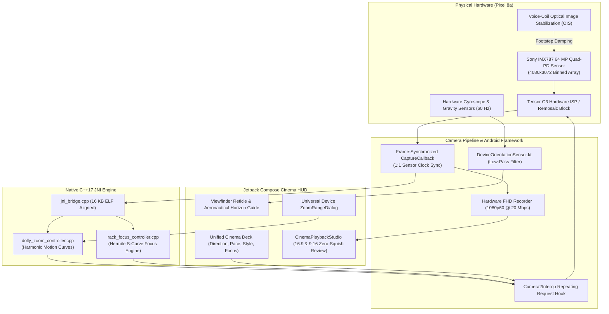

# 🎬 AI-Guided Cinematic Camera App
### Real-Time Frame-Synchronized Vertigo (Dolly Zoom) & Rack Focus Engine
*Engineered for Google Pixel 8a • Android 14 & 15 • Google Tensor G3 • Sony IMX787 64 MP Quad-PD Sensor*

[](https://developer.android.com)
[](https://kotlinlang.org)
[](https://developer.android.com/jetpack/compose)
[](https://developer.android.com/training/camerax)
[](https://developer.android.com/guide/practices/page-sizes)

---

## 📽️ Project Overview

The **AI-Guided Cinematic Camera** is a production-grade Android computational videography engine designed to recreate complex, multi-thousand-dollar Hollywood camera rig movements—specifically the **Hitchcock Vertigo shot (Dolly Zoom)** and **Automated Rack Focus**—handheld on a consumer smartphone.

By combining low-latency **Camera2 Repeating Request Injection**, a **C++ native cubic Hermite easing engine**, **4-pixel Quad-PD sensor crop alignment**, and **60 Hz IMU gyroscope horizon leveling**, the app achieves cinema-grade optical progression with zero motor shudder, zero edge warping, and zero frame drops.

---

## 🏛️ System Architecture



---

## 🚀 Key Technical Highlights & Innovations

### 1. 4-Pixel Quad-PD Bayer Alignment (1,020 Harmonic Quanta)
* **The Challenge**: Standard floating-point zooming or coarse 8-pixel quantization generated an alternating step-pause-jump sawtooth against continuous physical walking, causing high-frequency silhouette vibration.
* **The Solution**: Quantized the active sensor crop window to exact multiples of **4 pixels** (2 px left margin, 2 px right margin = 1 Bayer mosaic cell). For the Sony IMX787 active array ($4080\times3072$), this provides **1,020 harmonic quanta** ($680$ micro-steps between 1.0x and 3.0x), advancing $\approx 2.5$ steps on **every single frame at 60 FPS** with zero pause frames.

### 2. Live Super-Res Actuation vs. Software EIS Conflict ("Paper Flapping")
* **The Challenge**: Smartphone Electronic Image Stabilization (EIS) warps border mesh vertices across frames. Dynamic digital zooming confuses the EIS algorithm, creating violent boundary flutter ("paper flapping").
* **The Solution**: Disabled software EIS (`CONTROL_VIDEO_STABILIZATION_MODE_OFF`) while engaging hardware voice-coil Optical Image Stabilization (`LENS_OPTICAL_STABILIZATION_MODE_ON`) and direct repeating capture-request injection. This absorbs footstep impacts mechanically while preserving Tensor G3 full-sensor hardware remosaicing.

### 3. Coordinated Algorithmic Rack Focus (Native C++)
* **The Feature**: High-end cinema vertigo shots dynamically shift depth of field.
* **The Implementation**: Integrated a native C++ cubic Hermite puller (`f(tau) = 3*tau^2 - 2*tau^3`) driving Camera2 `CaptureRequest.LENS_FOCUS_DISTANCE` (diopters) in frame-accurate lockstep with optical zoom. Supports **Subject Lock (Continuous PDAF)**, **Pull to Background**, and **Pull to Actor**.

### 4. 60 Hz Gyroscope/Gravity Horizon Leveling Guide
* **The Feature**: Handheld walking introduces lateral roll tilt ($2^\circ$ to $5^\circ$), ruining the illusion of a mechanical dolly track.
* **The Implementation**: Fused Android's hardware gravity and accelerometer sensors with an exponential low-pass filter ($\alpha = 0.22$). Viewfinder reticle renders rotating aeronautical horizon wings that glow green ($\le 1.0^\circ$) when level and display a live warning degree pill (`TILT +2.4°`) when tilted.

### 5. Zero-Squish Multi-Aspect Ratio Viewport (16:9 & 9:16)
* **The Feature**: Videos recorded in vertical (9:16) or widescreen (16:9) often suffer from squishing or container metadata rotation clashes.
* **The Implementation**: Built a custom review studio (`CinemaPlaybackStudio.kt`) that reads container headers via `MediaMetadataRetriever` and `MediaPlayer.setOnVideoSizeChangedListener`, dynamically letterboxing/pillarboxing without distortion.

---

## 📂 Project Directory Structure

```
Camera_App/
├── app/
│   ├── src/main/
│   │   ├── cpp/                                # Native C++17 JNI Engine
│   │   │   ├── dolly_zoom_controller.cpp       # Deterministic zoom progression math
│   │   │   ├── rack_focus_controller.cpp       # Cubic Hermite focus puller
│   │   │   ├── kalman_filter.cpp               # Optical telemetry smoothing
│   │   │   └── jni_bridge.cpp                  # Zero-copy JNI bindings (16KB ELF aligned)
│   │   ├── java/com/cinematic/camera/
│   │   │   ├── camera/
│   │   │   │   └── CameraPipeline.kt           # CameraX & Camera2 Interop lifecycle
│   │   │   ├── engine/
│   │   │   │   ├── DollyZoomNativeBridge.kt    # JNI wrapper for Zoom engine
│   │   │   │   ├── RackFocusNativeBridge.kt    # JNI wrapper for Focus engine
│   │   │   │   └── CinematicDollyRenderer.kt   # OpenGL ES transcoding pipeline
│   │   │   ├── guidance/
│   │   │   │   ├── DeviceOrientationSensor.kt  # 60 Hz Gyroscope horizon tracker
│   │   │   │   └── HapticMetronome.kt          # Stride cadence tactile feedback
│   │   │   ├── ui/
│   │   │   │   ├── CinematicHUD.kt             # Viewfinder Reticle, Horizon, Cinema Dock
│   │   │   │   ├── CinemaPlaybackStudio.kt     # Dynamic 16:9 & 9:16 review player
│   │   │   │   └── CinematicTake.kt            # Shot telemetry data model
│   │   │   └── MainActivity.kt                 # Application lifecycle & progression loop
│   │   ├── res/
│   │   │   ├── drawable/                       # Adaptive vector launcher artwork
│   │   │   └── mipmap-anydpi-v26/              # Modern adaptive icons
│   │   └── AndroidManifest.xml
│   ├── CMakeLists.txt                          # NDK build script with 16KB flags
│   ├── build.gradle.kts                        # Gradle build configuration
│   └── proguard-rules.pro                      # R8 code shrinking & JNI preserve rules
├── technical_hurdles.md                        # Exhaustive 8-case engineering hurdle documentation
└── README.md                                   # Project showcase & architecture
```

---

## 🛠️ Building & Running

### Prerequisites
* **Android Studio**: Hedgehog (2023.1.1) or newer
* **Android SDK**: Compile SDK `34` (Android 14/15)
* **Android NDK**: Version `25.1.8937393` or newer
* **CMake**: Version `3.22.1` or newer
* **Target Device**: Physical Android device with Camera2 Full/Level 3 hardware support (optimized for Google Pixel 8a).

### Compilation
1. Clone the repository:
   ```bash
   git clone https://github.com/your-username/CinematicCameraApp.git
   ```
2. Open the project in Android Studio.
3. Allow Gradle to sync and CMake to generate native targets (`cinematic_engine`).
4. Connect your device via USB with USB Debugging enabled.
5. Press **`Shift + F10`** (or click **Run 'app'**).

---

## 📚 Technical Documentation & Deep-Dives

For an exhaustive breakdown of the operating system bottlenecks, optical artifacts, and mathematical solutions encountered during development, consult:
* **[Engineering Case Studies & Technical Hurdles](file:///d:/MyStorage/PROJECTS/Camera_App/technical_hurdles.md)**:
  * **Hurdle 1**: Hardware Super-Res Actuation vs. EIS Warp Clashing ("Paper Flapping")
  * **Hurdle 2**: Multi-Camera Parallax Pop & Lens-Switching Discontinuities
  * **Hurdle 3**: Android 15 16 KB Page-Size Memory Alignment
  * **Hurdle 4**: Human-in-the-Loop vs. Fragile Computer-Vision Tracking
  * **Hurdle 5**: Jetpack Compose SurfaceView Z-Order Collision
  * **Hurdle 6**: Video Transcoding Aspect Ratio Squishing, Rotation Metadata & Upright OpenGL ES
  * **Hurdle 7**: Continuous Zoom Scale Vibration & 4-Pixel Quad-PD Bayer Snapping
  * **Hurdle 8**: Universal Device Adaptation & Dynamic Hardware Lens Thresholding

---

## 📄 License
Designed and developed for portfolio and technical showcase purposes. All rights reserved.

